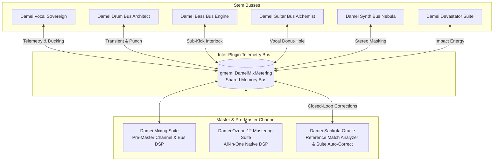

# Damei Audio Suite 🎛️⚡
### Next-Generation AI-Assisted Mixing, Mastering & Inter-Plugin Telemetry for Cockos REAPER

[](https://opensource.org/licenses/MIT)
[](https://www.reaper.fm/)
[](https://www.reaper.fm/sdk/js/js.php)

The **Damei Audio Suite** is a unified, retro-futuristic mixing and mastering ecosystem engineered natively in Cockos REAPER JSFX and Lua. It pairs professional console analog modeling, dynamic DSP, and multi-engineer signature profiles with an autonomous closed-loop inter-plugin shared memory bus (`gmem:DameiMixMetering`).

---

## 🌟 Architecture Overview

The Damei Suite functions as an intelligent distributed system inside your DAW:



---

## 📦 Suite Creations Catalog

### 1. Master & Pre-Master Engines
* **`Damei_MixingSuite.jsfx` (Pre-Master Channel & Bus DSP)**
  * **Analogue Punch**: Switchable British VCA, Opto 2A, and FET 76 compressors with sidechain HPF.
  * **Dynamic Resonance Control**: Adaptive dynamic de-box (mud removal) and dynamic de-harsh taming.
  * **Headroom Guardian**: Auto-headroom leveler enforcing strict commercial headroom (-6 dBTP pre-master target).
  * **22 Signature Producer Profiles**: Instant mix topologies modeled after top engineers including Dan Braunstein, Lance Prenc, Buster Odeholm, Will Putney, Zakk Cervini, Adam Nolly Getgood, and Jens Bogren.
  * **Song Structure AI**: Real-time chorus impact scanner that dynamically scales width and punch upon drop impact.

* **`Damei_OzoneSuite.jsfx` (Damei Ozone 12 Mastering Suite)**
  * All-in-one native mastering channel: IRC-style Transparent Maximizer, Dynamic EQ, Multiband Imager, Low-End Tamer, Spectral Stabilizer, Master Rebalance, and True Peak Limiting.

* **`Damei_AssessmentMatrix.jsfx` (Damei Sankofa Oracle)**
  * Real-time 7-band spectral divergence analyzer measuring your mix against offline-measured producer fingerprints or active library references.
  * Evaluates Integrated LUFS, Peak-to-Loudness Ratio (PLR), Crest Factor, Loudness Range (LRA), Stereo Correlation, and Lead Vocal Anchor Ratio.
  * Closed-loop auto-correction engine publishing trim commands over `gmem` directly to instrument busses.
  * Native Ollama AI & MIR Critic console with DirectML RTX 3060 acceleration.

* **`Damei_GullfossMaster.jsfx` (Auditory Perception & Psychoacoustic Dynamic EQ)**
  * Soundtheory Gullfoss computational auditory perception engine with real-time 16-band psychoacoustic masking threshold computation and dynamic de-masking (Recover, Tame, Bias, Brightness, Boost).


### 2. Instrument & Stem Bus Suites
* **`Damei_VocalSuite.jsfx` (Damei Vocal Sovereign)**
  * Lead vocal pocket sculpting, dynamic sibilance reduction, presence lift, vocal-to-guitar handshake carving, and 3D ambience halo.
* **`Damei_DrumSuite.jsfx` (Damei Drum Bus Architect)**
  * Transient attack & sustain shaper, Atumpan matrix, parallel drum crunch, kick-to-sub anchor, and drum shell punch meter.
* **`Damei_BassSuite.jsfx` (Damei Bass Bus Engine)**
  * Sub-bass harmonic exciter, kick-to-sub phase interlock, crossover management (Hamidovic split), and dynamic sidechain ducking.
* **`Damei_GuitarSuite.jsfx` (Damei Guitar Bus Alchemist)**
  * Mid/side guitar wall-of-sound sculpting, quad-tracked guitar coherence, palm-mute chug guard (dynamic 190Hz notch), and center vocal carve.
* **`Damei_SynthSuite.jsfx` (Damei Synth Bus Nebula)**
  * Multiband stereo dimension, exciter, ducking glue compressor, and SynBass low-end handshake.
* **`Damei_DevastatorSuite.jsfx` (Cinematic Hybrid FX & AI Co-Pilot)**
  * Riser/downer impact integration, sub-drop anchor, trailer brass excitement, and automatic chorus lift.

### 3. Satellites & Metering Utilities
* **`Damei_TonalBalance.jsfx`**: Tonal balance curve analyzer with commercial genre boundaries.
* **`Damei_Clipper.jsfx`**: Soft and hard converter bus clipper.
* **`Damei_Metering.jsfx` & `Damei_RefMetering.jsfx`**: K-System, EBU R128 LUFS, and true peak metering.
* **`Damei_SatelliteEQ.jsfx` & `Damei_SpectrumProbe.jsfx`**: Precision surgical probes.

---

## 🚀 One-Click Installation

Run the provided PowerShell installer from within the repository root:

```powershell
.\install.ps1
```

This will automatically copy:
1. All `.jsfx` files to `%APPDATA%\REAPER\Effects\Damei\`
2. All `.lua` scripts to `%APPDATA%\REAPER\Scripts\Damei\`

In REAPER:
1. Press `F5` in the FX Browser to rescan plugins.
2. Search for `Damei` to access any suite.

---

## 📖 Documentation Index
* [System Architecture & Shared Memory Bus](docs/ARCHITECTURE.md)
* [Mixing Suite User Guide](docs/MIXING_SUITE.md)
* [Ozone Mastering Suite User Guide](docs/MASTERING_SUITE.md)
* [Sankofa Oracle Reference Matcher Guide](docs/SANKOFA_ORACLE.md)
* [Instrument Bus Suites Guide](docs/BUS_SUITES.md)
