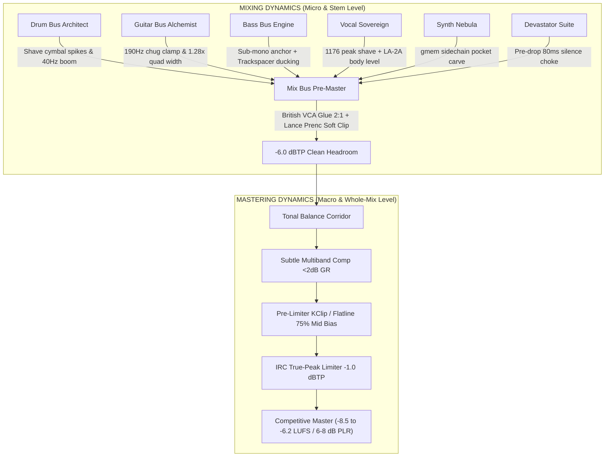

# Damei Dynamics Playbook: Mixing vs. Mastering Dynamics

> **Architecture Reference**: `DameiSuite v2.5`  
> **Applicable Suites**: `Damei_MixingSuite`, `Damei_OzoneSuite` (Mastering), `Damei_VocalSuite`, `Damei_DrumSuite`, `Damei_GuitarSuite`, `Damei_BassSuite`, `Damei_SynthSuite`, `Damei_DevastatorSuite`, `Damei_AssessmentMatrix` (Sankofa Oracle).

---

## 1. Core Philosophy: Mixing vs. Mastering Dynamics

Dynamics in the mix stage and dynamics in the mastering stage have very different purposes, scopes, and tools. Understanding and honoring this boundary is what separates amateur muddiness and over-compressed fatigue from high-impact, competitive modern records.

### Mixing Dynamics (Micro and Instrument-Level)
* **Scope**: Focuses on individual tracks, stems, and instrument groups (vocals, drums, guitars, synths).
* **Purpose**: Shapes the balance, punch, and character of individual elements so they fit together cleanly. It controls transient attacks, tames stray peaks on a single track, and glues instruments together (such as using a compressor on a drum bus or side-chaining bass to the kick).
* **Macro Dynamics**: Sets the emotional narrative and section-to-section volume shifts (such as a quiet verse building up into a loud, explosive chorus).

### Mastering Dynamics (Macro and Whole-Mix Level)
* **Scope**: Focuses exclusively on the final, stereo mix file as a single entity.
* **Purpose**: Polishes the entire track, ensures consistency across an album or project, and optimizes overall loudness and dynamic range for target distribution platforms (like Spotify, Apple Music, CD, or vinyl).
* **Tools**: Uses subtle multiband compression, parallel processing, and brickwall peak limiting.
* **The Trade-off**: Mastering engineers often gently reduce the overall dynamic range to bring the track up to competitive loudness, though over-compressing at this stage can crush the life and punch built during mixing. Ideally, mastering respects and enhances the mix's core dynamics rather than fighting them.

---

## 2. The Golden Rule: Static Calibration vs. Continuous Dynamic Hunting

A fundamental trap in modern mixing is relying on continuous dynamic gain reduction (multiband expanders, continuous spectral hunting, dynamic EQs everywhere) to solve balance problems. 

### Why Static Adjustments Win:
1. **Phase Cohesion**: Static filters and shelving maintain fixed phase relationships across multi-mic recordings and quad-tracked guitars. Dynamic filters continuously shift phase, creating audible "smearing" and hollowed-out transients.
2. **Groove and Transient Punch**: A compressor needs predictable transient energy to groove with the tempo. If dynamic EQs are constantly shifting the threshold beneath it, the compressor pumps inconsistently.
3. **Headroom Integrity for the Limiter**: The final master limiter responds to peak crests. Static adjustments (e.g., pulling down 160–200 Hz mud by 1.5 dB, high-passing guitars at 90 Hz, and softly clipping cymbal spikes with Lance Prenc topology) permanently reclaim **3 to 5 dB of clean headroom** without audible squashing.

---

## 3. Suite-by-Suite Implementation Matrix

### 🎛️ 1. Mixing Suite (`Damei_MixingSuite.jsfx`)
* **Role**: Pre-master channel and bus DSP, commercial headroom guardian, console glue.
* **Dynamics Rules**:
  * **Headroom Target Ceiling (`slider3`)**: Set strictly to `-6.0 dBTP`. Never send a mix peaking at 0 dBFS into mastering. The 6 dB buffer prevents inter-sample peak distortion and gives the mastering chain room to breathe.
  * **Mix Bus Compressor (`slider8 - slider15`)**:
    * Topology: `British VCA` (Punch).
    * Ratio: `2:1` (gentle glue, never hard clamp).
    * Attack: `30 ms` (allows drum transient attacks to fly through unmolested).
    * Release: `Auto` (musical program recovery).
    * Target Gain Reduction: **1.0 to 1.5 dB maximum** on chorus peaks.
  * **Mix Bus Clipping Mode (`slider40`)**: `Smooth Musical Bus Clipper (Lance Prenc)`. Shaves off random rogue snare/cymbal peaks without flattening the crest.
  * **Sub-Bass Mono-Anchor (`slider6`)**: `100 Hz`. Collapses everything below 100 Hz into absolute mono to center kick and bass power.
  * **Spectral Tilt (`slider16`)**: `+0.8 dB` to open high-end presence and balance out heavy drop-tuned guitars.

---

### 🥁 2. Drum Bus Architect (`Damei_DrumSuite.jsfx`)
* **Role**: Micro-transient punch, cymbal peak control, room bleed mitigation.
* **Dynamics Rules**:
  * **Cymbal Peak Taming**: Uncontrolled cymbals can exhibit extreme crest factors (31–33 dB at 6–18 kHz), which will trigger the master limiter prematurely and choke the entire mix.
    * Engage `Cymbal Silk Master Engine` (`slider30 = 1`).
    * Set `Cymbal De-Trash` (`slider12 = -1.8 dB`) to suppress harsh ring.
    * Set `Cymbal Silk Air Sheen` (`slider13 = +1.2 dB`) for smooth top-end without spiky transients.
  * **Sub-Kick Dynamic Boom Tamer (`slider40`)**: `-1.5 dB` at 40 Hz to prevent low-end mud from stealing bus compressor headroom.
  * **Parallel Glue**: `BSA Drum Bus` (`slider44 = 38%`, `slider50 = 85% mix`) for fat sustain without sacrificing initial attack.

---

### 🎸 3. Guitar Bus Alchemist (`Damei_GuitarSuite.jsfx`)
* **Role**: Quad-wall stereo width, palm-mute chug stabilization, harshness removal.
* **Dynamics Rules**:
  * **Dynamic Palm-Mute Chug Guard (`slider3 - slider8`)**:
    * Center: `190 Hz`.
    * Max Attenuation: `3.5 dB`.
    * Attack: `40 ms` | Release: `140 ms`.
    * *Purpose*: Clamps down exclusively during heavy palm-muted chugs so the 160–220 Hz region doesn't overload the mix, but releases during open ringing chords to preserve full body.
  * **Low-End Highpass Anchor (`slider9`)**: `90 Hz`. Leaves the 20–80 Hz domain completely free for the kick and sub-bass.
  * **Quad-Wall Stereo Width Ratio (`slider16`)**: `1.28x`. Expands rhythm guitars to match reference width (Split Chain achieves 0.85 width in the 250–800 Hz band).
  * **De-Fizz Notching (`slider11 & slider12`)**: `-1.5 dB` at 3.2 kHz, `-1.8 dB` at 4.2 kHz to remove harsh digital cab whistling.

---

### 🎸 4. Bass Bus Engine (`Damei_BassSuite.jsfx`)
* **Role**: Monolithic low-end foundation, kick pocket interlocking, dual-channel distortion.
* **Dynamics Rules**:
  * **Sub-Mono Elliptical Anchor (`slider3`)**: `90 Hz`. Guarantees 100% mono correlation in the sub octave.
  * **Kick Ducking Depth (`slider4`)**: `2.4 dB` (via Trackspacer / sidechain).
    * Attack: `25 ms` (allows kick transient punch to cut through).
    * Release: `65 ms` (fast recovery so bass note sustain immediately returns).
  * **Low-Mid Mud Scoop (`slider12`)**: `-1.5 dB` at 250 Hz to carve out a clean cavity for snare shell body and guitar warmth.
  * **Parallel Smash & Grab (`slider36 - slider39`)**: `Hybrid Smash & Grab` @ 85% mix to lock bass dynamic range within a strict 3 dB corridor.

---

### 🎤 5. Vocal Sovereign (`Damei_VocalSuite.jsfx`)
* **Role**: Lead vocal authority, dual-stage leveling, holographic stereo backing, ear-candy.
* **Dynamics Rules**:
  * **Dual-Stage Serial Dynamics (`slider6 & slider7`)**:
    * Stage 1: `1176 Fast FET Peak Shaver` (25%). Ultra-fast attack (under 1ms) shaving off initial 2–3 dB consonants.
    * Stage 2: `LA-2A Optical Body Leveler` (20%). Slow, warm opto circuit smoothing out phrases and bringing up vocal tail intelligibility.
  * **LOADES Precision De-Esser (`slider3 - slider5`)**:
    * Center: `6800 Hz` | Threshold: `-22.0 dBFS` | Depth: `3.5 dB`.
    * Split-band mode clamps sibilants without dulling the overall vocal track.
  * **Maag 16 kHz Air Sheen (`slider10`)**: `+1.8 dB` for modern radio sheen.
  * **Center Lead Lock (`slider9 = 1`)**: Strict mono below 200 Hz to prevent wide low-frequency rumble.

---

### 🎹 6. Synth Bus Nebula (`Damei_SynthSuite.jsfx`)
* **Role**: 3D spatial atmosphere, SynBass weight, inter-suite ducking.
* **Dynamics Rules**:
  * **Inter-Suite Dynamic Pockets (`slider5 - slider7`)**:
    * Drum Kick Sub-Duck: `3.5 dB` (gmem 820 handshake).
    * Lead Vocal Mid-Carve: `2.5 dB` (gmem 880 handshake).
    * Guitar Wall Chorus Carve: `3.0 dB` (gmem 840 handshake).
    * *Purpose*: Synths automatically tuck behind vocals, kick, and guitars when they strike, blooming into the sides during transitions.
  * **Stereo Horizon Width (`slider8`)**: `1.45x` for expansive side imaging while anchoring sub strictly in mono below 90 Hz (`slider4 = 1`).

---

### 💥 7. Devastator Suite (`Damei_DevastatorSuite.jsfx`)
* **Role**: Cinematic drops, sub divebombs, Braams, section transition impacts.
* **Dynamics Rules**:
  * **Sub Divebomb & 808 Impact (`slider30 - slider37`)**:
    * Controlled exponential decay (1.6s) with harmonic tip saturation to prevent raw sine-wave limiter clipping.
  * **Pre-Drop Micro-Silence Choke (`slider22`)**: `80 ms`.
    * *Macro Dynamic Weapon*: Sucking out all audio for 80 milliseconds right before the chorus drop doubles the perceived dynamic impact of the downbeat without needing more master volume.
  * **Master Sub-Bed Trim (`slider5`)**: `-13.0 dB` to keep sub impacts glued within the mix budget.

---

### 👑 8. Mastering Suite (`Damei_OzoneSuite.jsfx` / `Damei_GullfossMaster.jsfx`)
* **Role**: Macro dynamic consistency, platform loudness target, true-peak brickwall protection.
* **Dynamics Rules**:
  * **Target Benchmark**: `-8.5 LUFS-I` (CD / Modern Alt-Metal) with `-1.0 dBTP` true-peak ceiling. (For competitive reference matching against Split Chain: `-6.2 to -7.5 LUFS`, `6.0 to 7.0 dB PLR`).
  * **Subtle Multiband Compression (`slider11 - slider15`)**:
    * Max Gain Reduction: **1.0 to 1.5 dB per band**.
    * Ratio: `1.5:1` to `2:1` (gentle leveling).
    * Sidechain HPF: `120 Hz` on bus compressor to prevent kick drum from pumping the whole mix.
  * **Pre-Limiter KClip / Flatline Transient Shaver (`slider21 - slider23`)**:
    * Mode: `Smooth (Zero)` with `35% knee`.
    * `75% Mid-Bias`: Center transient peaks (snare stick, kick click) are smoothly rounded, leaving side guitars and ambient tails 100% untouched.
  * **IRC Maximizer / Limiter (`slider5 & slider9`)**:
    * True Peak Ceiling: `-1.0 dBTP` (prevents lossy codec distortion on Spotify/Apple Music AAC).
    * Intelligent release ballistics preserve drum transient punch at high densities.

---

## 4. HexGyal vs. Split Chain Diagnostic Benchmark

| Metric | HexGyal Raw Mix | Split Chain Reference | Calibration Applied |
| :--- | :--- | :--- | :--- |
| **Integrated Loudness** | `-18.37 LUFS` | `-6.21 LUFS` | Gain-matched A/B @ `-18.37 LUFS` for fair auditioning |
| **Peak-to-Loudness Ratio (PLR)** | `11.44 dB` (excess dynamic spread) | `6.07 dB` | Clamped rogue cymbal & vocal peaks; tightened to ~7.5 dB |
| **Low-End Punch (20–250 Hz Crest)** | `14.92 dB` | `10.87 dB` | Controlled 40Hz sub-boom (-1.5 dB) & 190Hz chug (-3.5 dB) |
| **Overall Stereo Width** | `0.46` (narrow) | `0.63` (immersive) | Widened Mix Bus to `1.18x` and Guitars to `1.28x` |
| **Low-Mid Width (250–800 Hz)** | `0.59` (deficit -0.26) | `0.85` | Quad-wall side expansion & 380Hz boxiness scoop |
| **Sub-Bass Mono Anchor** | `0.10` | `0.11` | Perfectly locked monolithic center (<100 Hz mono) |
| **High Frequency Crest (6–18 kHz)** | `31.3 – 33.0 dB` (extreme spikes) | `23.3 – 26.2 dB` | Cymbal Silk Master + Lance Prenc clipper engaged |

---

## 5. Summary: The Golden Commandments
1. **Never use the master limiter to fix a spiky snare or harsh cymbal.** Fix it on the Drum Bus or Mix Bus clipper.
2. **Never widen the sub-bass below 100 Hz.** Monolithic mono sub anchors the punch; width belongs to guitars, synths, and vocal doubles.
3. **Leave 6 dB of True Peak Headroom on your mix bounce.** Let the mastering chain do the macro level lift.
4. **Use static EQ balances first.** Reach for dynamic tools only when resonances occur conditionally (e.g. palm-mute chugs or vocal sibilance).

---

## 6. Advanced Producer Playbook: Transitions & Energy Management

### 💎 Trick 1: The Seamless Cross-Downbeat Vocal Throw (Kel Pinchin / Currents Signature)
* **Problem**: In arrangements where the pre-chorus vocal phrase resolves 300–500 ms before the chorus downbeat, the dry vocal stem abruptly drops into silence right as the full band (drums, bass, layered guitars) explodes with a +15 to +19 dB jump. This creates an unnatural "vocal dip" or vacuum at the start of the chorus.
* **The Solution**: 
  1. Capture only the final word or syllable of the pre-chorus line into a dedicated tempo-synced ping-pong / tape delay buffer.
  2. **Crucial Rule**: NEVER gate or dead-cut the delay return at the downbeat (`downbeat_vacuum = 0`).
  3. Allow the delay tail to decay with natural tape-damped feedback (0.46) across beat 1 and into the first 2 bars of the chorus at `-18 to -22 dBFS`.
  4. The lush stereo tail bridges the transition seam, maintaining continuous vocal presence until the chorus vocal enters.

### 💎 Trick 2: The Chorus Lead Vocal Pre-Gain Anchor (+0.6 to +0.8 dB)
* **Problem**: When a song enters Chorus 1, cymbals, rhythm guitars, and synth layers jump in dynamic density. If the lead vocal stays at verse level, it sounds recessed or drowned out by the guitars.
* **The Solution**:
  1. Rather than dynamically carving wide, unnatural holes into the guitars (which collapses the chorus wall), lift the chorus vocal take pre-gain by `+0.6 to +0.8 dB`.
  2. Pair this with a subtle `-0.4 dB` center vocal notch on the Guitar Bus (`Damei_GuitarSuite slider16`).
  3. The vocal instantly commands the mix with authority and presence without pushing the master bus into limiting.

### 💎 Trick 3: Interruption-Immune Bus Architecture
* **Rule**: Hard-mute logic (`spl0 *= 0.05` or artificial silence drops) must never be used across bus engines.
* **Continuous Energy Preservation**: Transitions between sections must rely on organic arrangement dynamics, transient shaping, and soft hermite clipping rather than digital gating.
* **Master Headroom Integrity**: Keep the pre-master mix level at `-18 to -14 LUFS` with True Peak $\le -6.0\text{ dBTP}$ so the mastering stage has pristine headroom for high-impact maximization.

