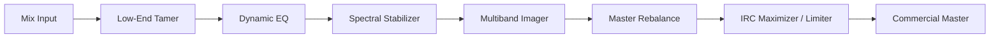

# Damei Ozone 12 Mastering Suite (`Damei_OzoneSuite.jsfx`)

## Overview
The **Damei Ozone 12 Mastering Suite** is an all-in-one native mastering DSP plugin engineered to provide commercial loudness, high-fidelity spectral balance, and low-end translation without external CPU-heavy plugins.

## Architecture & Signal Flow

## Key DSP Modules

1. **Low-End Tamer & Sub Anchor**
   * Eliminates phase cancellation in the 20 - 90 Hz region.
   * Tightens sub boom while maintaining body for streaming loudness.

2. **Multiband Dynamic EQ**
   * Automatically reacts to momentary tonal imbalances.
   * 4 target bands with independent threshold, ratio, attack, and release.

3. **Spectral Stabilizer**
   * Continuous dynamic smoothing across the frequency spectrum.
   * Eliminates ear fatigue and resonance spikes during high-energy choruses.

4. **Multiband Stereo Imager**
   * Ensures sub-bass (below 100 Hz) is 100% mono for punch and vinyl/club compatibility.
   * Controlled stereo expansion for mid and high frequencies.

5. **IRC Transparent Maximizer & True Peak Limiter**
   * Inter-sample true peak limiter prevents ISP clipping on lossy streaming codecs (Spotify, Apple Music).
   * Intelligent release control preserves transient impact on drums even at high loudness (-6 to -8 LUFS).
